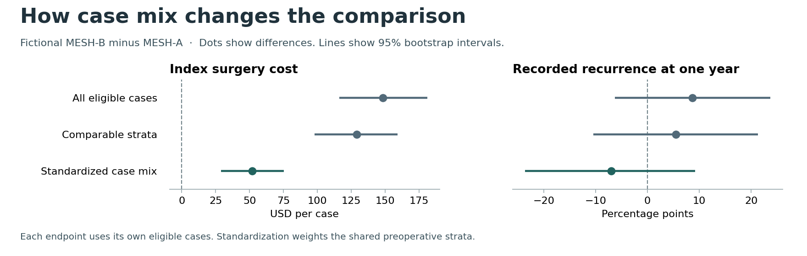

# Surgical case cost and outcomes

## Does the recurrence difference between meshes persist after adjusting for patient risk?



Of **113 synthetic ventral hernia repairs**, 106 met the criteria for the 365-day recurrence analysis. In those cases, crude recurrence with MESH-B was **8.7 percentage points higher** than with MESH-A. Restricting the comparison to risk groups represented by both meshes reduced the gap to **+5.4 points**. Giving both meshes the same mix of preoperative diabetes and surgical risk reversed the estimate to **−7.0 points**. Its 95% bootstrap interval spans **−23.6 to +9.1 points**, leaving the direction of the difference uncertain.

How much does one record matter? In the overlap group with no prior repair, a defect under 5 cm and no diabetes, MESH-B had **0 recurrences in 6 cases**. Changing one of those six outcomes to a recurrence moves the adjusted difference from **−7.0 to −0.6 points**. Changing two moves it to **+5.7 points**, with the same patients and risk weights. [Case IDs, counts and sensitivity bounds](outputs/event_sensitivity.md) · [Runnable example](examples/event_sensitivity.py)

MESH-B also cost **$148.29 more per surgery** in the crude comparison and **$51.86 more** after adjustment. The cost and recurrence analyses each use the cases eligible for that endpoint. These fictional results illustrate how patient mix changes the comparison and why the estimates cannot establish a clinical preference. [Results, case counts, and sensitivity to missing follow-up](outputs/report.md)

## Follow a purchase price into the operating room

One box of six MESH-A implants goes from **$720 to $726** on synthetic PO-100. The associated invoice, INV-380, goes from **$120 to $121 per implant**. The purchasing reconciler exports the revised price as 12,100 cents per implant. Case S001 uses one implant, so its total goes from **$4,304.50 to $4,305.50**. Across the ventral series, exactly **55 of 113 case totals** increase by $1. [Trace the order and invoice in the purchasing project](https://github.com/chandlerbrown4/hospital-purchasing-reconciliation#follow-one-box-into-a-surgical-case) · [Baseline implant lines](outputs/implant_lineage.csv) · [Case totals](outputs/case_audit.csv)

With `hospital-purchasing-reconciliation` checked out beside this repository, run the walkthrough from here.

```sh
python3 examples/check_purchasing_handoff.py
```

The script changes temporary copies of the PO, its replay and the invoice. It runs the purchasing reconciler, verifies the source references in the exported price evidence, and passes the catalog to the surgical CLI. It checks every case against its implanted quantity. Use `--purchasing PATH` for a different checkout location. [Walkthrough code](examples/check_purchasing_handoff.py)

GitHub Actions verifies the price change using fresh checkouts of both projects. The handoff job checks the new total for S001 and counts every case whose cost changed. [View the verified walkthrough](https://github.com/chandlerbrown4/surgical-case-outcomes/actions/runs/45445859485/job/138629333952) · [Run the workflow](https://github.com/chandlerbrown4/surgical-case-outcomes/actions/workflows/verify.yml)

Each pull request and update to the main branch runs the handoff alongside the standalone checks. Choose **Run workflow** to repeat it on demand.

## What counts as a comparable repair?

A separate series of 19 fictional inguinal repairs follows two cases from procedure coding to the 30-day outcome comparison.

- **G19 looks like an initial repair on the operating list.** Its label matches the other 18 operations. The diagnosis and procedure codes on the same account and date both identify a recurrent repair. Excluding G19 reduces the number of potential same-surgeon, same-side pairs from seven to six. [Operative rows](data/matching/operations.csv) · [Billing rows](data/matching/billing.csv) · [Case-level decisions](outputs/coded_cases.csv)
- **G04 returned to hospital on day 8.** Six potential pairs become five with prices on both sides and three with both prices and observable 30-day outcomes. In G04’s group, three MESH-B patients could match one MESH-A patient. One MESH-B patient returned. A one-to-one pairing can contain zero or one return depending on who is chosen. [Follow-up records](data/matching/follow_up.csv) · [Group counts and event bounds](outputs/matching_review.md)

## Run

From this directory, with Python 3.11 or newer and no third-party packages:

```sh
python3 -m surgical
python3 -m surgical --prices /path/to/device_prices.csv --output /path/to/results
python3 -m unittest discover -s tests
```

The default run recreates the main reports and case-level audit files in [outputs](outputs/). Run `python3 -m examples.event_sensitivity` to print the one- and two-case sensitivity table.
Set `--output` to keep a custom-price run alongside them.

To try a second cohort, run `python3 -m surgical --cohort data/alternate_cohort.json`. Its three cases exercise a different cutoff, missing price data, and a comparison too small for adjustment. The report is written to `build/cohort/report.md`. [Cohort format and example](docs/cohort-input.md)

## Eligibility and cost evidence

Each retained diabetes and surgical-risk group needs at least five eligible patients per mesh. Six MESH-B cases fall outside the overlap for each endpoint, and one case with unknown diabetes status is excluded from both analyses. The report also gives bounds for recurrence when follow-up is incomplete. [Cohort accounting](outputs/report.md#cohort-accounting) · [Standardization and precision](outputs/report.md#standardization-and-precision)

In 1,000 simulations with **zero true mesh effect**, risk adjustment reduced the mean crude difference from +10.04 to +0.03 points with complete follow-up. When MESH-B recurrences were less likely to be observed, the mean adjusted difference was −7.23 points. [Calibration assumptions and results](outputs/calibration.md) · [Simulation code](examples/calibration.py)

S011 lacks a complete implant price and remains eligible for the recurrence analysis. S001 shows how copying a six-pack price into a per-implant field can overstate a case by **$600**. [Implant price lineage](outputs/implant_lineage.csv) · [Other cost lines](outputs/other_cost_lines.csv) · [Case audit](outputs/case_audit.csv)

## Price input contract

The included [device_prices.csv](data/device_prices.csv) has the exact UTF-8 header:

```csv
device_id,effective_from,effective_to,unit_price_cents,currency,price_source
```

A row applies from its ISO date `effective_from` through the day before
`effective_to`. Leave the end blank for an open interval. Use integer USD
cents per implant and a populated source. Adjacent intervals are valid.
Overlapping intervals or malformed prices stop the run before output is written.
An uncovered device or date leaves its implant line and case total unpriced.
The demo includes MESH-A at $120.00 each and MESH-B at $175.00 each, both
effective January 1, 2025 with source `reconciled_invoice`.

[Fixture source](surgical/fixture.py) contains the independently invented
source records. [Analysis](surgical/analysis.py) defines case eligibility and
aggregation, pooled direct standardization, and fixed-seed bootstrap intervals.

The optional [figure script](examples/plot_comparison.py) redraws the README chart from the analysis. With Matplotlib installed, run `python3 -m examples.plot_comparison` from this directory.
